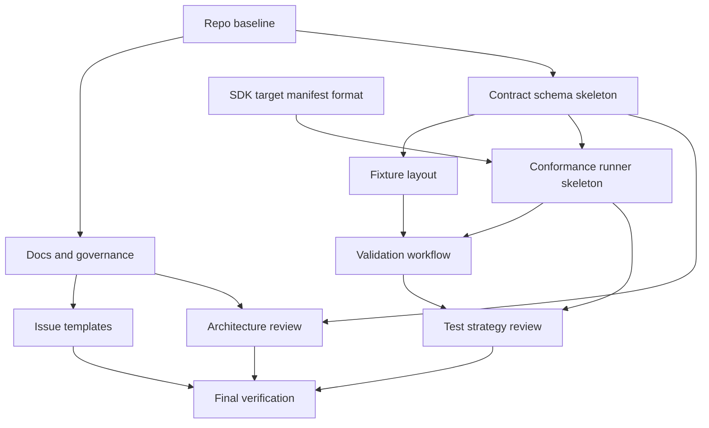

# KalshiCore

KalshiCore is the parent contract and conformance repository for Kalshi SDK
implementations. It owns shared API contracts, fixtures, target manifests, and
conformance expectations that language-specific SDK repositories validate
against.

KalshiSharp is the first and reference target. It remains an idiomatic .NET SDK:
KalshiCore defines the shared truth it must satisfy, while KalshiSharp owns its
public API shape, runtime behavior, packaging, and .NET-specific ergonomics.
Future SDK repositories should follow the same model for their language
ecosystems rather than inheriting generated client design from this repository.

## Repository Model

- `contracts/` defines reviewed API contract material and schema metadata.
- `fixtures/` contains request, response, and behavior examples used by
  conformance checks.
- `targets/` records SDK target manifests that describe how each implementation
  is validated.
- `tools/` contains shared validation and conformance tooling.
- `docs/` explains architecture, target onboarding, and contract governance.

This repository should stay focused on shared contract truth and compatibility
checks. SDK repositories own language-specific abstractions, dependencies,
release cadence, and user-facing documentation.

## Bootstrap DAG

The initial repository build is intentionally small and dependency ordered:

Each step should produce enough structure for the next step without turning
KalshiCore into a generated SDK framework. Conformance should prove shared
behavior; SDKs should remain idiomatic.

## Documentation

- [Architecture](docs/ARCHITECTURE.md)
- [SDK Targets](docs/SDK_TARGETS.md)
- [Contract Change Policy](docs/CONTRACT_CHANGE_POLICY.md)
- [SDK Boundaries](docs/SDK_BOUNDARIES.md)
- [Contributing](CONTRIBUTING.md)
